<div align="center">


# NeoChat

**پیام‌رسان خصوصی شبیه تلگرام، روی سرور خودتان — فقط با یک فایل اجرایی**

A private, Telegram-style messenger for your own server — shipped as a single binary.

[دانلود آخرین نسخه / Download](https://github.com/neoauroraproject/neochat/releases/latest) ·
[راهنمای کامل / Full guide](docs/BINARY_EDITION.md)

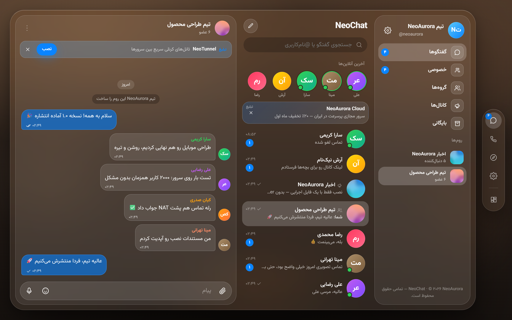

</div>

## چرا NeoChat؟

- **یک فایل، بدون وابستگی** — وب‌سرور، پایگاه داده، رله تماس، اپ وب/موبایل و پنل مدیریت همه داخل یک باینری ~۱۲ مگابایتی. بدون Docker.
- **کار در قطعی اینترنت بین‌الملل** — هیچ CDN یا سرویس خارجی لازم نیست؛ فونت‌ها و آیکون‌ها داخل برنامه‌اند.
- **بدون شماره تلفن** — حساب فقط با نام کاربری و رمز عبور.
- **تماس صوتی و تصویری** — صفحه تماس شبیه واتس‌اپ، تصویر خودی قابل جابه‌جایی؛ WebRTC با رله TURN داخلی که پشت NAT هم وصل می‌شود.
- **انیمیشن‌های نرم** — ورود و خروج صفحه‌ها، نوار پایین با نشانگر فنری، عنوان جمع‌شونده و پیام‌هایی که نرم وارد می‌شوند.
- **گروه و کانال** — لینک عمومی یا دعوت خصوصی، مدیران، پاسخ، ویرایش، تیک خوانده‌شدن، آخرین بازدید.
- **عکس، ویدیو، فایل و پیام صوتی** — با محدودیت حجم قابل تنظیم و پیش‌نمایش سبک.
- **آفلاین** — گفتگوها و رسانه‌ها روی دستگاه کش می‌شوند؛ قابل نصب به‌عنوان اپ (PWA).
- **پنل مدیریت کامل** — برندینگ، ثبت‌نام، محدودیت‌ها، SSL، تماس، تبلیغات، کاربران و پشتیبان‌گیری.

## تصاویر

|                        موبایل روشن                         |                        موبایل تیره                        |                           گفتگو                           |                        تماس تصویری                        |
| :--------------------------------------------------------: | :-------------------------------------------------------: | :-------------------------------------------------------: | :-------------------------------------------------------: |
| 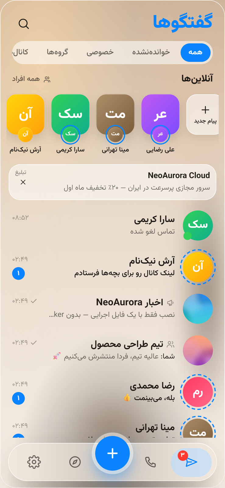 | 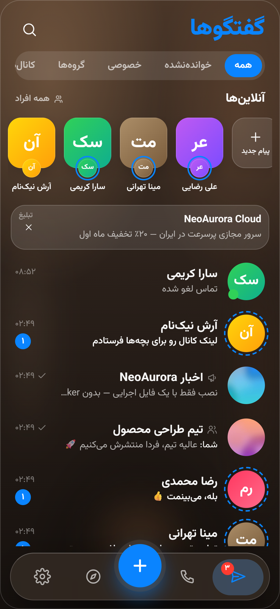 | 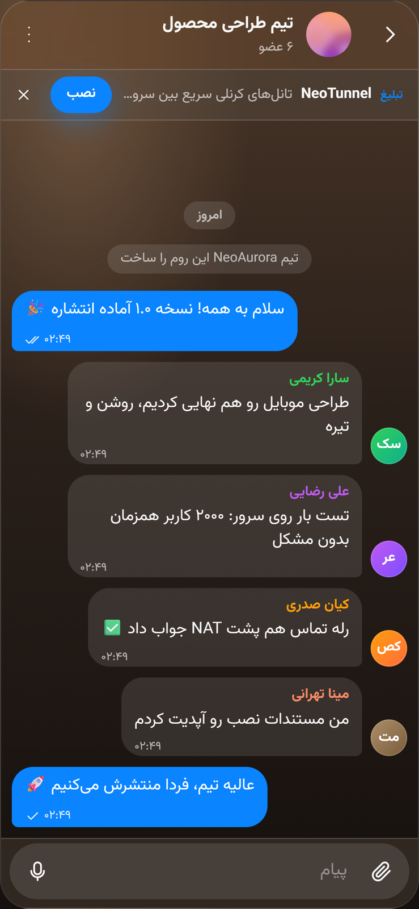 | 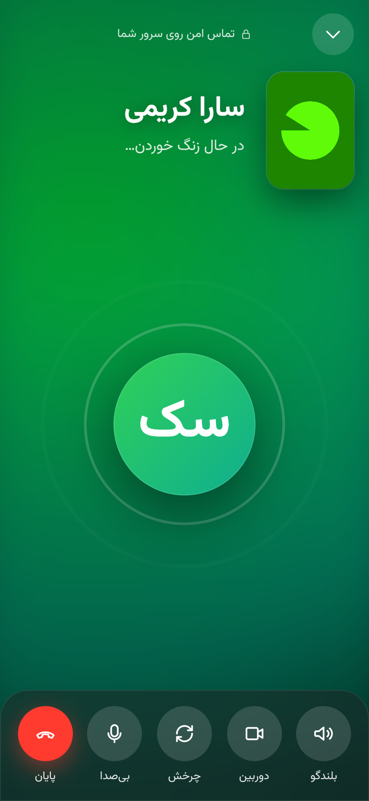 | 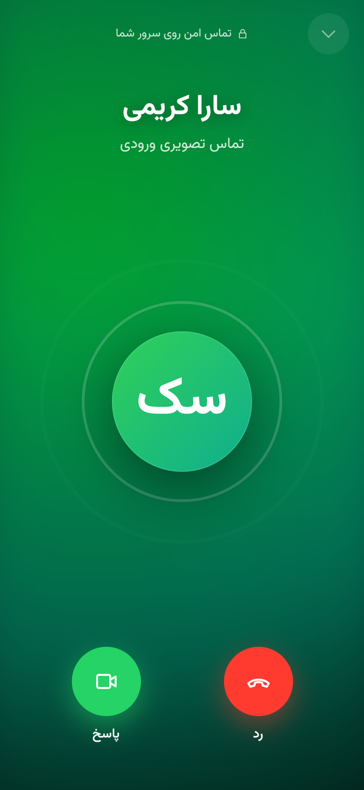 |

|                         دسکتاپ روشن                         |                        English UI                        |
| :---------------------------------------------------------: | :------------------------------------------------------: |
| 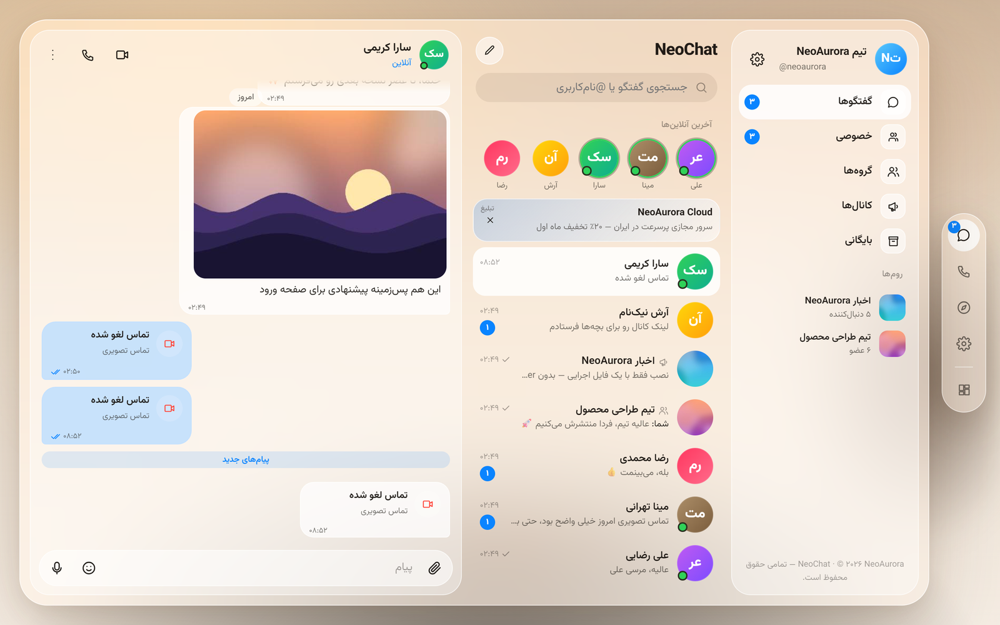 | 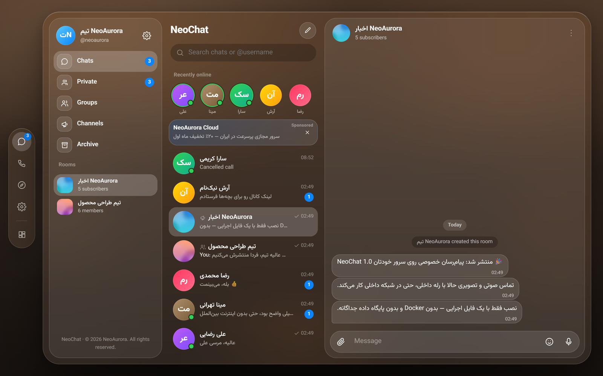 |

|                        داشبورد مدیریت                         |                     SSL از داخل پنل                     |                           برندینگ                            |
| :-----------------------------------------------------------: | :-----------------------------------------------------: | :----------------------------------------------------------: |
| 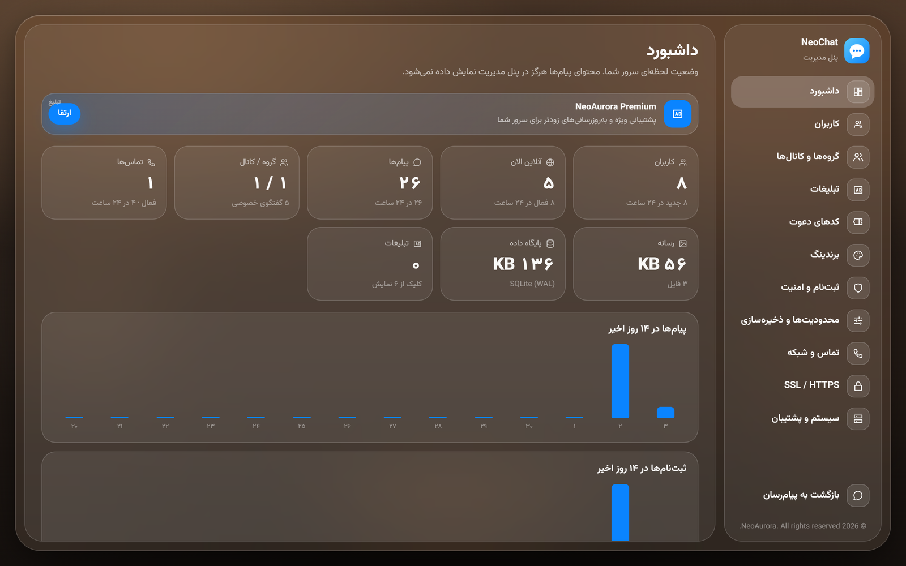 | 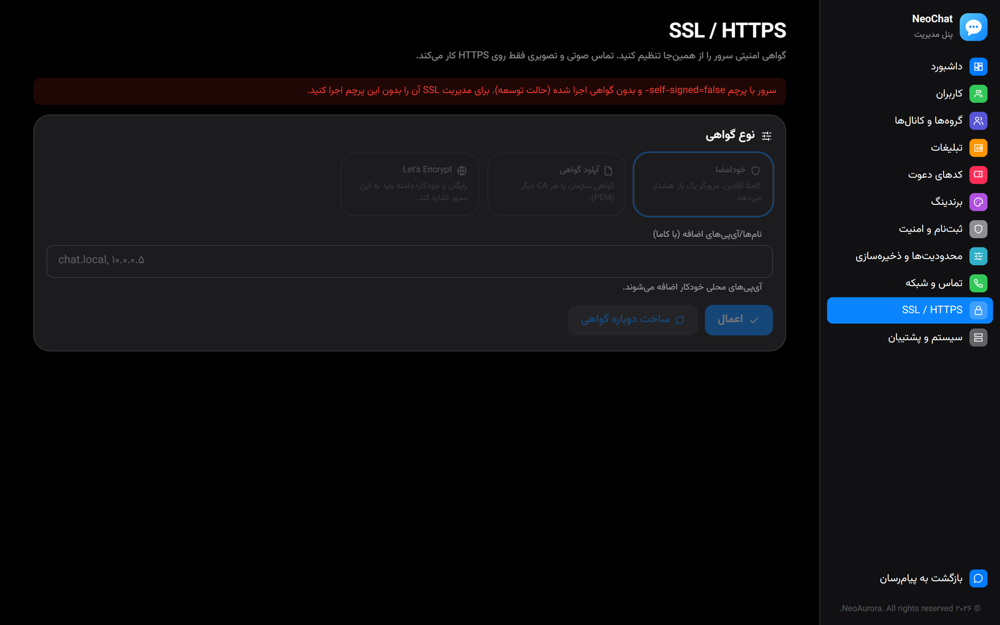 | 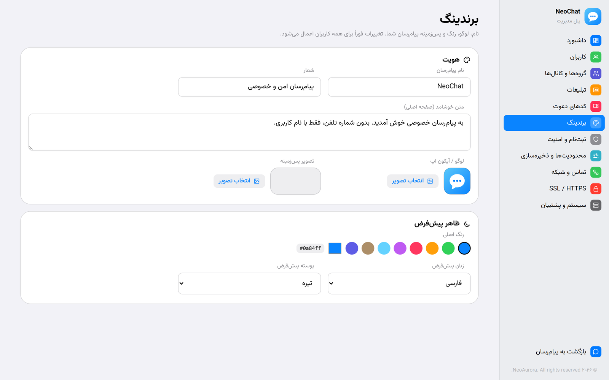 |

## نصب در ۳۰ ثانیه

```bash
curl -L -o neochat https://github.com/neoauroraproject/neochat/releases/latest/download/neochat-linux-amd64
chmod +x neochat && sudo mv neochat /usr/local/bin/
sudo neochat -addr :443 -http-redirect :80 -data /var/lib/neochat
```

آدرس `https://IP-سرور` را باز کنید؛ اولین بازدید، حساب مدیر را می‌سازد. پنل مدیریت در `/admin` است.

- پورت‌ها: `443/tcp` (اپ و API) و `3478/udp+tcp` (رله تماس)
- سرویس دائمی: [`deploy/binary/neochat.service`](deploy/binary/neochat.service)
- ویندوز: `neochat-windows-amd64.exe` را اجرا کنید (پیش‌فرض `https://IP:8443`)

> تماس فقط روی HTTPS کار می‌کند. گواهی خودامضا خودکار ساخته می‌شود؛ از **پنل مدیریت ← SSL** می‌توانید گواهی خودتان را آپلود کنید یا Let's Encrypt بگیرید، بدون ری‌استارت.

## Quick start (English)

Download the binary for your platform from [Releases](https://github.com/neoauroraproject/neochat/releases/latest) and run it:

```bash
sudo neochat -addr :443 -http-redirect :80 -data /var/lib/neochat
```

Open `https://<server-ip>/` — the first visit creates the admin account. Everything else
(branding, registration, upload limits, SSL certificates, calls/TURN, ads, backups) is configured in `/admin`.
See the [full guide](docs/BINARY_EDITION.md) for flags, security notes and building from source.

## ساخت از سورس

```bash
sh scripts/build-binary.sh     # Linux/macOS  —  pwsh scripts/build-binary.ps1 on Windows
```

نیازمند Node 20+ و Go 1.24+ فقط روی ماشین ساخت. خروجی برای Linux / Windows / macOS (amd64 و arm64) در `release/`.

| مسیر                     | محتوا                                                 |
| ------------------------ | ----------------------------------------------------- |
| `server/`                | سرور Go: API، WebSocket، SQLite، رله TURN، مدیریت SSL |
| `client/`                | اپ React (دسکتاپ شیشه‌ای + موبایل) و پنل مدیریت       |
| `docs/BINARY_EDITION.md` | راهنمای کامل                                          |

پوشه‌های `apps/` و `packages/` نسخه قدیمی مبتنی بر Docker هستند و برای نسخه باینری لازم نیستند.

---

<div align="center">

© 2026 **NeoAurora**. All rights reserved.

</div>
