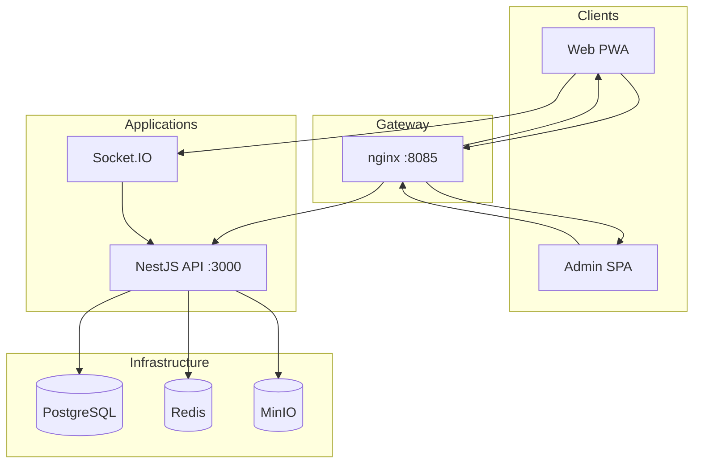

# Architecture

NeoChat is an npm workspaces monorepo targeting self-hosted, E2EE chat. Phase 3 adds the messaging
layer on top of the Phase 2 foundation: identity, configuration, admin, providers, plugins, and
deployment tooling.

## System overview

## Layering

| Layer            | Location                  | Responsibility                                             |
| ---------------- | ------------------------- | ---------------------------------------------------------- |
| Bootstrap env    | `@neochat/config`         | Validate `process.env` once at startup                     |
| Runtime config   | API Configuration Service | DB-backed settings; feature modules inject typed config    |
| Shared contracts | `@neochat/shared`         | Zod schemas + TypeScript types for API/clients             |
| Providers        | `@neochat/providers`      | Pluggable storage (MinIO/S3), calls, notifications, search |
| Plugins          | `@neochat/plugins`        | Plugin manifest, lifecycle, host interface                 |
| Crypto           | `@neochat/crypto`         | Double Ratchet, Sender Keys, X3DH (client-side)            |

## API (Phase 3 scope)

The NestJS API (`apps/api`) exposes:

### Foundation (Phase 2)

- **Auth** — setup wizard, register, login, refresh, logout, sessions
- **Users** — profile, devices, search, avatar upload
- **Admin** — users, config, feature flags, audit, invites, retention, TLS
- **Health** — live, ready, diagnostics
- **System** — instance metadata

### Messaging (Phase 3)

- **Chats** — DM, group, channel CRUD; members; drafts; pins; read cursors
- **Messages** — send, edit, delete, forward, reactions, receipts
- **Keys** — E2EE device bundle publish/fetch
- **Media** — presigned MinIO upload/download
- **Presence** — heartbeat, online status
- **Search** — user and message search (Postgres)
- **Realtime** — Socket.IO gateway for live message delivery

Database schema lives in `apps/api/drizzle/`:

- `0000_foundation.sql` — users, auth, config, audit, invites
- `0001_messaging.sql` — chats, messages, reactions, keys, media objects

## Configuration model

1. `.env` / container env → parsed by `BootstrapEnvSchema` in `packages/config/src/bootstrap.ts`
2. Bootstrap values seed the Configuration Service on first run
3. Admin UI and API patch runtime config by category/key
4. Feature modules receive config via NestJS providers — **never** `process.env`

Key env vars for Phase 3:

| Variable           | Default (Compose)  | Purpose                        |
| ------------------ | ------------------ | ------------------------------ |
| `STORAGE_PROVIDER` | `minio`            | Object storage backend         |
| `MINIO_*`          | see `.env.example` | MinIO connection               |
| `CALL_PROVIDER`    | `none`             | LiveKit optional (not Phase 3) |

## Admin panel

The admin SPA (`apps/admin`) connects to Phase 3 admin APIs:

- Dashboard with health diagnostics cards (DB, Redis, storage, disk, CPU, plugins)
- User management (suspend/activate, role, force logout)
- Invites (create/list/revoke)
- Feature flags (messaging toggles grouped by category)
- Config editor (safe categories)
- Instance settings (single-tenant `instanceName` — no multi-org schema)
- Retention policies + storage status
- Plugin host status
- Audit log

## Security principles

- Admin surfaces never decrypt or display message plaintext
- JWT access tokens are short-lived; refresh tokens are peppered and stored hashed
- Argon2id for password hashing
- E2EE happens on clients; server stores ciphertext envelopes only

## Deployment modes

| Mode        | Entry                      | Notes                                   |
| ----------- | -------------------------- | --------------------------------------- |
| Local dev   | Direct app ports           | Infra in Docker, apps via `npm run dev` |
| Stage-1     | `NEOCHAT_HTTP_PORT` (8085) | Single nginx gateway                    |
| Stage-2 TLS | Caddy profile              | See `deploy/docker-compose.tls.yml`     |
| Offline     | Pre-built image bundle     | `scripts/build-offline-bundle.sh`       |

## Related docs

- [`DEVELOPMENT.md`](DEVELOPMENT.md) — local workflow
- [`API_REFERENCE.md`](API_REFERENCE.md) — endpoint summary
- [`USER_GUIDE.md`](USER_GUIDE.md) — end-user guide
- [`OPS.md`](OPS.md) — production operations
- [`PLUGIN_API.md`](PLUGIN_API.md) — plugin host
